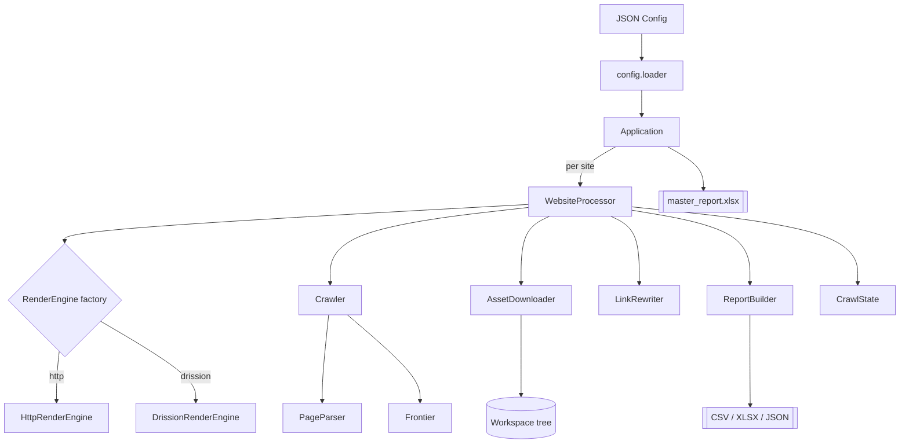

# Architecture

WebArchiver is a layered, dependency-inverted pipeline. Control flows top-down
(CLI → Application → WebsiteProcessor → components); every component depends on
abstractions and typed data records rather than on each other's internals.

## Layered view

```
CLI (main.py)
  └─ Application                 orchestrates all sites + master report
       └─ WebsiteProcessor       one website, end-to-end
            ├─ RenderEngine      fetch pages/assets (HTTP | DrissionPage)
            ├─ Crawler           BFS over the Frontier, drives PageParser
            ├─ AssetDownloader   concurrent, hash-deduplicated downloads
            ├─ ScreenshotService full-page captures (browser engine)
            ├─ LinkRewriter      offline clone
            ├─ ReportBuilder     pages/assets/crawl/broken/dup/external + sitemap
            └─ CrawlState        atomic checkpoint for --resume
```

## Component diagram

See [`diagrams/architecture.mmd`](diagrams/architecture.mmd).



## Class diagram

See [`diagrams/class.mmd`](diagrams/class.mmd). The key seam is the abstract
`RenderEngine`, implemented by `HttpRenderEngine` and `DrissionRenderEngine`.
`WebsiteProcessor` accepts an `engine_factory`, which is how tests inject a stub
engine and how Playwright could be added later.

## Sequence

See [`diagrams/sequence.mmd`](diagrams/sequence.mmd) for the full crawl→report
flow, including the streaming `on_page` callback that persists HTML and
checkpoints state during the crawl.

## Key design decisions

**Dependency inversion at the engine boundary.** The crawler and downloader
never import a browser library directly; they use `RenderEngine`. aiohttp is
imported lazily inside `HttpRenderEngine.start()`, so the package (and its test
suite) imports cleanly even where aiohttp/Chromium are absent.

**Streaming persistence for resume.** Pages are written to disk and the crawl
state is checkpointed *during* the crawl (every N pages and on phase
transitions), not only at the end. `CrawlState.save()` writes to a temp file and
atomically renames it, so a crash never leaves a corrupt checkpoint. `--resume`
restores the frontier (queue + visited set) and already-collected records.

**Two-phase asset handling.** During the crawl, asset *references* are collected
and de-duplicated by URL. After the crawl, the `AssetDownloader` fetches each
unique URL once, hashes the bytes (SHA-256) and reuses the stored file for
identical payloads — so duplicate content is detected and storage is saved.

**Offline rewrite as a post-pass.** Link rewriting runs after all pages and
assets are on disk, when the full URL→local-path map is known. Each saved page
is re-read, rewritten (internal hyperlinks, `img`/`script`/`link`/`source`/
`video` references and `srcset`) to relative paths, and written back.

**Safe, deterministic naming.** Every filesystem path is allocated centrally by
`Workspace`, which sanitises components (blocking traversal, reserved Windows
names and over-long segments), folds query strings into a short hash, and
guarantees per-directory uniqueness.

**Failure isolation.** Each website runs inside its own try/except in
`Application`; a per-site crash is recorded in that site's `SiteSummary` and the
batch continues. Within a site, individual fetch/download failures become broken
link / failed asset records rather than aborting the run.

## Concurrency & rate limiting

- `asyncio` drives both crawling and downloading.
- The crawler processes the frontier in concurrency-bounded BFS batches.
- A shared `AsyncRateLimiter` (token bucket) caps requests per second.
- `retry_async` applies exponential backoff with jitter on transient errors
  (network errors, timeouts, and retryable HTTP statuses 408/429/5xx).

## Module responsibilities (SRP)

| Package | Responsibility |
|---|---|
| `config` | typed models + JSON load/validate |
| `core` | url utils, naming, hashing, logging, rate limiting, exceptions |
| `fetch` | `RenderEngine` interface, HTTP & DrissionPage engines, factory |
| `crawl` | frontier, robots policy, BFS crawler |
| `extract` | page parser, asset classifier, domain records |
| `download` | concurrent asset downloader + dedupe |
| `archive` | workspace/storage tree, offline link rewriter |
| `screenshot` | full-page capture service |
| `report` | exporters, reporters, sitemap, master report, summaries |
| `state` | crawl checkpoint (resume) |
| `pipeline`/`app`/`main` | orchestration & CLI |
